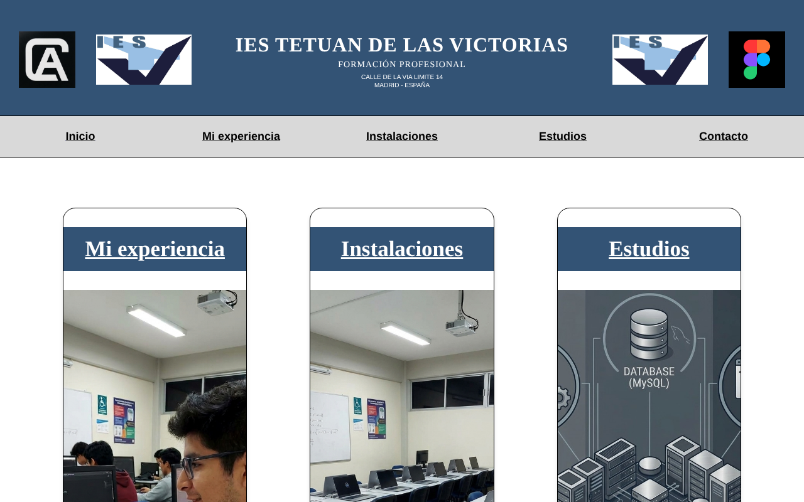

# Web del IES Tetuán de las Victorias · HTML + CSS

Sitio web de tres páginas sobre el IES Tetuán de las Victorias, realizado en el módulo de Diseño de Interfaces Web del CFGS de Desarrollo de Aplicaciones Web.

## Páginas
- **Inicio** (`index.html`): presentación del centro y la formación profesional
- **Estudios** (`html/estudios.html`): información sobre los ciclos
- **Instalaciones** (`html/instalaciones.html`): aulas, cafetería y ubicación

## Características
- Diseño responsive adaptado a móvil, tablet y escritorio con media queries
- Maquetación con Flexbox
- Navegación común entre páginas y una hoja de estilos por sección

## Tecnologías
HTML5 · CSS3

## Cómo verlo
Clona el repositorio y abre `index.html` en el navegador.

## Captura

## Autor
Carlos Alberto García Espinoza
